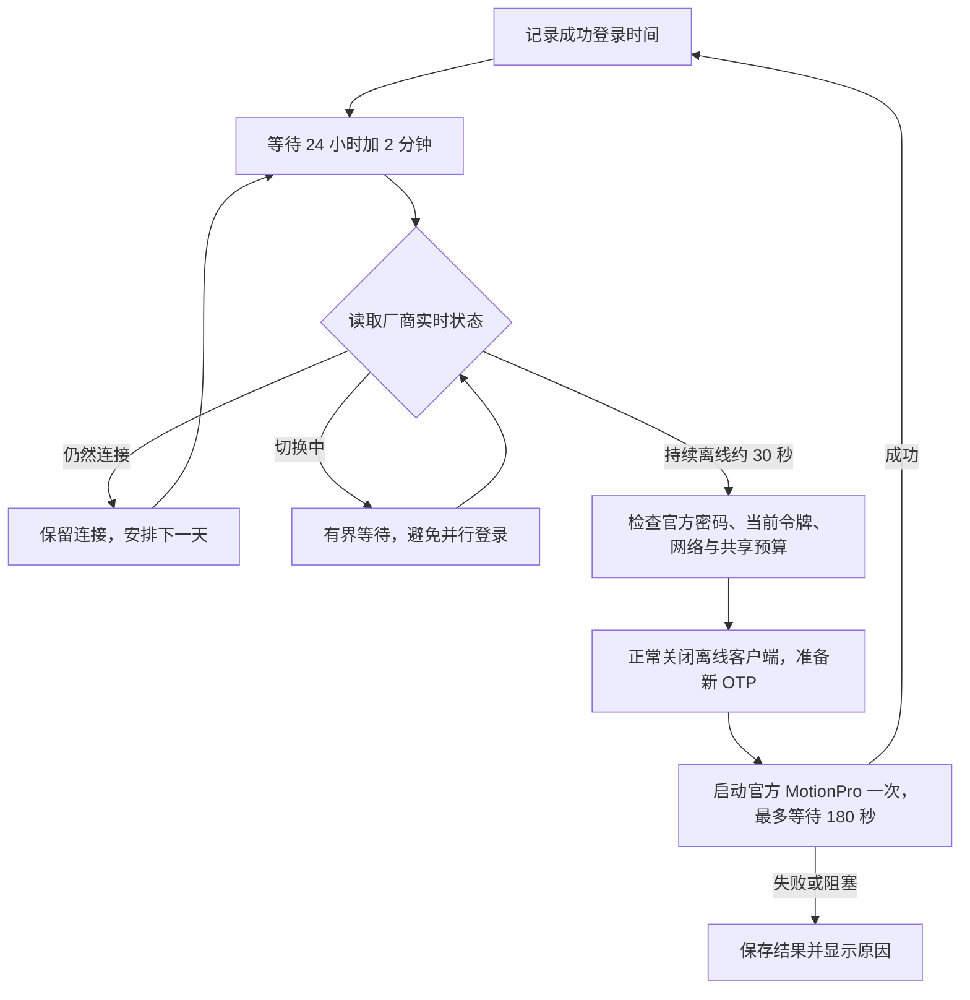

# MotionPro Guard OSS

macOS 上的 MotionPro VPN 自动恢复助手，包含后台程序和原生桌面小组件。**当前版本：1.6.1。** 默认记录最近成功登录时间，在 **24 小时加 2 分钟**后检查一次，确认已断开才重新登录；平时不轮询 VPN。

使用官方 MotionPro 已保存的静态密码，每次登录重新读取本机 MotionProOTP 当前绑定来计算口令。默认流程不需要 OTP 窗口或 Guard 的旧钥匙串副本，也不需要模型 API。

**许可证：GNU GPL v3 或更新版本（GPL-3.0-or-later）。** 许可证全文见 [LICENSE](LICENSE)。这是独立社区工具；MotionPro、MotionProOTP 和厂商库属于各自权利人，不包含在仓库和源码包内。

This source-only macOS helper schedules recovery from the last successful VPN login. It reuses the official client's saved password and current local OTP binding. Vendor applications, personal credentials, signing material, and runtime records are not distributed.

## 工作方式



- 新成功登录更新计时起点。到期仍在线则安排下一天；未知状态不重启。启动和点击“立即检查”可以进行一次检查。
- 提前意外断线无法即时发现。24 小时是本策略的预期时长，不保证服务器一定在该时刻断开。
- 自动与人工备用提交共用滚动一小时最多两次的预算；连续两次已提交失败暂停。前置检查或等待不增加提交次数。
- launchd 保持 Guard 运行；看护助手无周期触发。不自动创建助手定时检查任务。
- 原生小组件显示“定时恢复”；点击后可查看上次成功登录和下次恢复时间。计划等待期间的旧快照不能当作实时隧道状态。

详细顺序、事务恢复和成功标准见 [架构](docs/architecture.md) 与 [验收](docs/acceptance.md)。

## 构建和安装

需要 macOS 14+、Xcode Command Line Tools、Python 3，以及自己合法安装和配置的官方 MotionPro/MotionProOTP。

1. 先用官方客户端手动登录一次，保存静态密码，并将目标 VPN 设为默认站点。每台电脑单独绑定自己的 OTP。
2. 将 [project.example.json](project.example.json) 复制为 `project.local.json`，只填写自己的网关主机名，不填写账号或秘密。
3. 使用自己的持久代码签名身份构建和安装：

   ```bash
   python3 build.py --config project.local.json --signing-identity YOUR_CERTIFICATE_SHA1
   python3 install.py --install 'dist/MotionPro Guard OSS.app'
   python3 install.py --enable-jobs
   open -a "$HOME/Applications/MotionPro Guard OSS.app" 'motionpro-guard-oss://open'
   ```

4. 在管理页点击“选择官方 OTP 数据源”，选择本机已绑定的 `VSite.plist`。点击“检查登录条件”和“立即检查”，确认已记录成功登录时间，再开启“预计到期后自动恢复”。
5. 右键桌面 → 编辑小组件 → 搜索 **MotionPro Guard OSS**。

首次安装默认关闭自动恢复。公开版使用独立标识 `org.motionproguard.app`、数据目录 `MotionProGuardOSS` 和 URL scheme `motionpro-guard-oss`；不会替换已有 Guard。不要同时运行两套恢复引擎。

完整设置、系统授权和安装边界见 [安装说明](docs/setup.md)。

## 源码检查

```bash
python3 build.py --ad-hoc
python3 -m unittest discover -s Tests -p 'test_*.py'
python3 scripts/release_audit.py
```

`--ad-hoc` 只构建开发产物并运行合成测试，不安装、启动或登录。正式安装要求使用者自己的持久证书；不提供原作者证书、私钥或预签名应用。

```bash
# 只运行 Swift 合成测试
python3 build.py --test-only
# 用户明确要求实时状态时才执行
python3 scripts/preflight.py
python3 scripts/manual_attempt.py status
```

可复用 Codex skill 位于 [skills/motionpro-vpn-access](skills/motionpro-vpn-access/SKILL.md)。可选人工备用模板位于 [automation](automation/README.md)，需要使用者单独配置和授权，不随安装启用。

## 限制与验证范围

- 配置加解密只接受源码中固定的两种已核对客户端构建；不匹配时停止。源代码不包含厂商密钥或二进制。见 [兼容性](docs/compatibility.md)。
- 锁屏时的后台取码和定时触发已实现；**新版完整锁屏重连和公开版在新设备上的自然周期恢复仍需实测**。合成测试或原本机的单次登录成功不能代替这项验收。
- 休眠、关机和未登录桌面时不会执行；唤醒后再处理到期计划。提前断线需要用户主动检查。
- 日志无法提供可信成功时间时，不虚构计时起点。VPN 隧道恢复也不代表 SSH/HPC 会话或业务认证已经恢复。

## 发布内容

仓库包含源码、合成测试、构建安装工具、脱敏诊断和迁移文档。排除账号密码、OTP 种子与口令、官方配置、钥匙串、个人路径、证书指纹、真实日志、运行状态和恢复备份。

[更新记录](CHANGELOG.md) · [安全说明](SECURITY.md)
