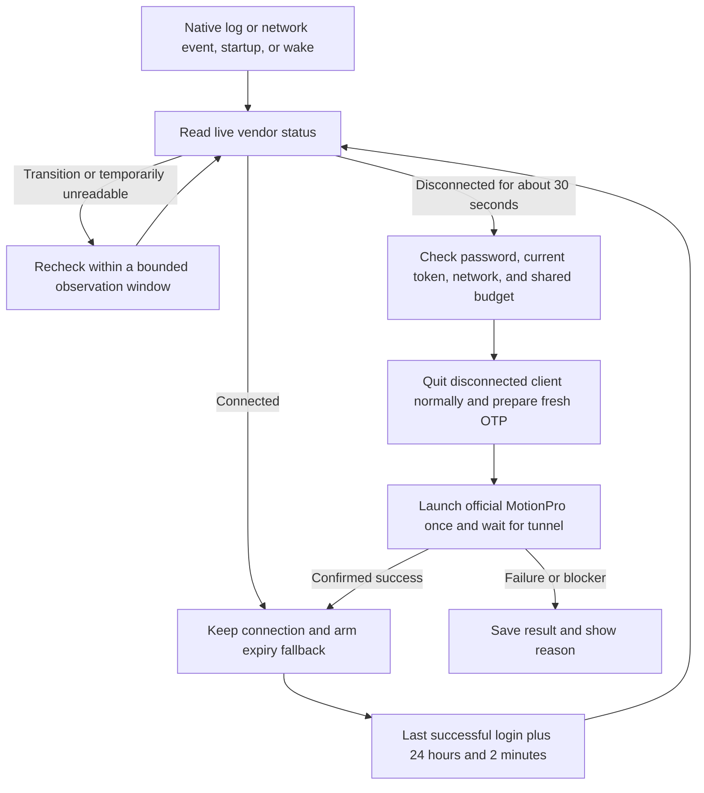

# MotionPro Guard OSS

An automatic recovery helper for MotionPro VPN on macOS, with a background app and a native desktop widget. **Current version: 1.6.5.** Guard listens for MotionPro log events and system network changes. It confirms a disconnection for about 30 seconds before reconnecting. Idle monitoring does not poll VPN status at a fixed interval.

**Prerequisite: install both official MotionPro and MotionProOTP on the same Mac that runs Guard, and complete their local login and setup before enabling automatic recovery.** MotionPro must have a saved static password, and MotionProOTP must have a locally bound token for the intended VPN account. Setup on another computer or phone does not provide this Mac's saved password or token binding.

Guard uses the static password saved by the official MotionPro client. For each login, it reads the current local MotionProOTP binding and calculates a one-time password (OTP). The default flow does not require the OTP window, an old copy of credentials in Guard's Keychain, or a model API.

**License: GNU GPL v3 or later (GPL-3.0-or-later).** See [LICENSE](LICENSE) for the full text. This is an independent community tool distributed as source code. MotionPro, MotionProOTP, and vendor libraries belong to their respective rights holders and are not included in this repository or its source archives.

## How it works



- Native notifications request a live status check. They do not authorize a login on their own. Guard coalesces event bursts and observes for up to 180 seconds, with status checks about 10 seconds apart. Unknown status never counts toward the 30-second disconnection requirement. A known desktop-only mode stops the observation.
- A successful login also schedules a fallback check **24 hours and 2 minutes** later. If the VPN is still connected, Guard preserves it and schedules the next day. This interval is an expected session duration, not a server guarantee.
- Automatic and manual fallback logins share a default limit of two submissions per rolling hour. Two consecutive submitted failures pause recovery. Readiness checks and waiting do not count as submissions. A time-limited, explicitly authorized test grant allows one extra submission, is consumed by the next Guard submission, and retains history and failure protection. First installation has no such grant.
- Pause recovery or take manual control before deliberately disconnecting. An enabled Guard can recover from a manual disconnection too. It waits while you operate the client in the foreground on an unlocked desktop.
- `launchd` keeps Guard running. The watchdog helper has no periodic trigger. Installation does not create a scheduled task for an AI assistant.
- The native widget shows **Disconnect recovery** (`断线自恢复`) when recovery is enabled, the last observed state is connected, and at least one native listener started. Errors and holds take display priority. **Expiry fallback check** (`到期补充检查`) shows the backup schedule. A saved snapshot is not live tunnel status.

See [Architecture](docs/architecture.md) and [Acceptance criteria](docs/acceptance.md) for state handling, interrupted-attempt recovery, and success criteria. The linked guides are currently in Chinese.

## Build and install

Requirements: macOS 14 or later, Xcode Command Line Tools, Python 3, and your own legally installed copies of both official macOS apps, MotionPro and MotionProOTP, on this Mac. The app UI is currently in Chinese; exact button labels are included below.

1. Complete the initial setup in both official apps on this Mac:
   - **MotionPro:** log in successfully once, save the static password, and set the target VPN as the default site.
   - **MotionProOTP:** sign in with the intended VPN account and complete token binding on this Mac. Repeat this setup separately on each Mac where Guard will run.
   - After setup, Guard uses the saved password and local token binding for recovery. You do not need to keep the OTP window open or manually enter credentials for each recovery.
2. Copy [project.example.json](project.example.json) to `project.local.json`. Set your gateway hostname without adding an account name or secrets.
3. Build and install with your own persistent code-signing identity:

   ```bash
   python3 build.py --config project.local.json --signing-identity YOUR_CERTIFICATE_SHA1
   python3 install.py --install 'dist/MotionPro Guard OSS.app'
   python3 install.py --enable-jobs
   open -a "$HOME/Applications/MotionPro Guard OSS.app" 'motionpro-guard-oss://open'
   ```

4. In the management window, click **Choose official OTP source** (`选择官方 OTP 数据源`) and select the local `VSite.plist` for your bound token. Click **Check login readiness** (`检查登录条件`) and **Check now** (`立即检查`). Confirm readiness, then enable **Recover after disconnection** (`断线后自动恢复`). A trustworthy successful-login time also enables the expiry fallback.
5. Right-click the desktop, select **Edit Widgets**, and search for **MotionPro Guard OSS**.

Automatic recovery is disabled on first installation. The public edition uses the separate bundle identifier `org.motionproguard.app`, data directory `MotionProGuardOSS`, and URL scheme `motionpro-guard-oss`. It does not replace an existing Guard installation. Do not run two recovery engines at the same time.

See the [Setup guide](docs/setup.md) (Chinese) for full configuration, macOS permissions, and installation details. The installer supports first installation and refuses to overwrite an existing app; existing installations need a coordinated upgrade that preserves local settings, pending transactions, and attempt history.

## Build and test from source

```bash
python3 build.py --ad-hoc
python3 -m unittest discover -s Tests -p 'test_*.py'
python3 scripts/release_audit.py
```

`--ad-hoc` builds development artifacts and runs synthetic tests, including native file notifications on temporary fixtures. It does not install or launch the app, or submit a VPN login. Installation requires your own persistent signing certificate. The author's certificate, private key, and pre-signed applications are not provided.

```bash
# Run only the Swift synthetic tests
python3 build.py --test-only
# Run only when the user explicitly requests a live status check
python3 scripts/preflight.py
python3 scripts/manual_attempt.py status
```

The reusable Codex skill is in [skills/motionpro-vpn-access](skills/motionpro-vpn-access/SKILL.md). Optional manual fallback templates are in [automation](automation/README.md). They require separate configuration and authorization and are not enabled during installation. These guides are currently in Chinese.

## Limitations and validation status

- Configuration encryption and decryption support only the two verified client builds identified in the source. Guard stops on a mismatch. Vendor keys and binaries are not included. See [Compatibility](docs/compatibility.md) (Chinese).
- **A 1.6.5 candidate passed one event-driven reconnect on a separate test Mac after a manually induced disconnection.** The same Guard process detected the network event, submitted one official-client login while locked, confirmed attribution, and restored the tunnel. Independent observations then showed at least 60 seconds of stable connection, with a maximum sampling gap of about 12 seconds. The one-time test grant was consumed and prior history was preserved.
- That test used local configuration and signing. Authentication on a fresh public-edition installation and recovery after a naturally expired 24-hour session remain unverified. One successful recovery does not establish long-term reliability. See [Acceptance criteria](docs/acceptance.md).
- Guard runs in a logged-in macOS session. It does not recover while the Mac is asleep, shut down, or logged out; waking requests a new check. Listener readiness means at least one notification source started, not that every notification source works on every machine.
- If logs cannot provide a trustworthy successful-login time, Guard does not invent an expiry anchor. Native events can still trigger checks. Restoring the VPN tunnel does not restore SSH/HPC sessions or application authentication; those require separate verification.

## Distribution

This repository includes source code, synthetic tests, build and installation tools, sanitized diagnostics, and migration documentation. It excludes account credentials, OTP seeds and codes, official client configurations, Keychains, personal paths, certificate fingerprints, real logs, runtime state, and recovery backups.

[Changelog](CHANGELOG.md) · [Security](SECURITY.md) (Chinese)
