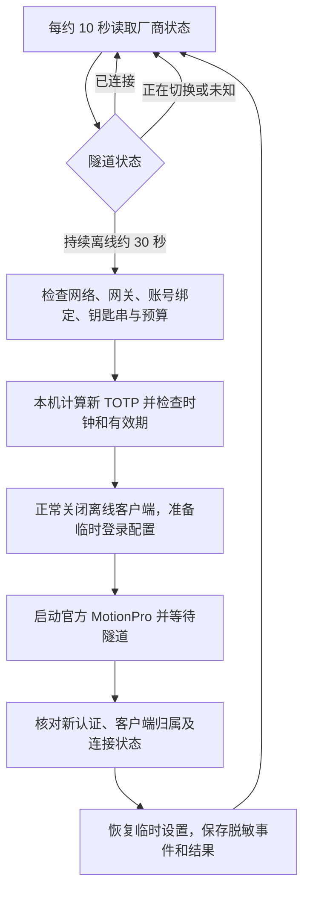

# MotionPro Guard OSS

macOS 上的 MotionPro VPN 断线恢复助手，包含本地守护程序、原生 WidgetKit 小组件、离线 TOTP、钥匙串存储、限次重试、健康看护和可选的 GPT 备用流程。

**许可证：GNU GPL v3 或更新版本（GPL-3.0-or-later）。** 许可证全文见 [LICENSE](LICENSE)。本项目是独立社区工具；MotionPro、MotionProOTP 和厂商库属于其各自权利人，不包含在本仓库及源码包内。

This is a source-only community helper for MotionPro on macOS. It combines local recovery, Keychain-backed offline TOTP, bounded retries, a native widget, a watchdog, and an optional assistant-operated fallback. Vendor applications and personal credentials are not distributed.

## 工作方式



- 主流程在本机执行。官方 MotionPro 负责认证和真正的 VPN 隧道。
- 当前离线 OTP 实现支持已核对的 HMAC-SHA1 时间口令，使用系统 Unix 时间。首次导入必须跨两个周期与官方应用比较。
- 自动与人工备用提交共用滚动一小时最多两次的预算；连续两次已提交失败后保留暂停状态。
- 看护任务约每 60 秒检查 Guard。它只管理 Guard 服务，不重启 VPN 服务。
- 可选 GPT 备用任务每 10 小时检查一次。模板见 [automation](automation/README.md)；它不是安装程序自动创建的任务。

详细顺序、失败处理和成功标准见 [流程说明](docs/architecture.md)。

## 支持范围

- macOS 14 或更新版本，Apple Silicon 或 Intel，已安装 Xcode Command Line Tools。
- 官方 MotionPro 安装在标准应用目录，厂商 `vpn_cmdline` 已安装。
- 原配置必须存在，账号与目标网关一致，并设为默认站点。
- 本版厂商配置加解密适配只支持源码中明确固定的一种客户端二进制构建。它通过 SHA-256 拒绝未经核对的版本；见 [兼容性](docs/compatibility.md)。
- 后台取码限于用户自己的、明确授权导入的已有令牌。令牌格式或账号绑定改变时停止恢复。

公开版使用独立标识 `org.motionproguard.app`、独立数据目录 `MotionProGuardOSS` 和独立 URL scheme `motionpro-guard-oss`。构建不启动应用；安装器也不会替换已有 Guard。不要同时启用两套恢复引擎。

## 构建和安装

1. 运行离线合成测试：

   ```bash
   python3 build.py --test-only
   python3 -m unittest discover -s Tests -p 'test_*.py'
   python3 scripts/release_audit.py
   ```

2. 将 [project.example.json](project.example.json) 复制为 `project.local.json`，只填写自己的网关主机名。不要填写账号、密码、种子或 OTP。此文件已被 Git 忽略。

3. 使用自己的持久代码签名证书构建：

   ```bash
   python3 build.py --config project.local.json --signing-identity YOUR_CERTIFICATE_SHA1
   python3 install.py --install 'dist/MotionPro Guard OSS.app'
   python3 install.py --enable-jobs
   ```

   首次安装创建关闭自动恢复的策略。完成下述本机设置之后，再通过管理界面开启恢复。

4. 完成本机设置：导入已保存的静态凭据、允许当前签名程序读取其专用钥匙串条目、选择自己已绑定的 OTP 数据文件，并跨两个周期核对官方口令。详细步骤见 [安装与授权](docs/setup.md)。

开发者可运行 `python3 build.py --ad-hoc` 检查完整 app 和 widget 的编译；临时签名版本不能完成固定证书的钥匙串授权，安装器会拒绝它。

可选 CI 模板在 [examples/github-actions-check.yml](examples/github-actions-check.yml)。需要 GitHub Actions 时，由具备 workflow 写入权限的维护者放到 `.github/workflows/`；源码发布默认不启用 CI。

## 只读检查和自然验收

```bash
python3 scripts/preflight.py
python3 scripts/manual_attempt.py status
"$HOME/Applications/MotionPro Guard OSS.app/Contents/MacOS/MotionProGuard" --watchdog-inspect
```

已连接时保留隧道。自然到期后按 [验收方法](docs/acceptance.md) 串联提交、新认证、L3 隧道、归属确认和计数增长；锁屏验收还要锁屏与接管证据。

## 公开版的验证程度

原本机版本曾观察到一次自然到期后的全程锁屏恢复成功。公开版由其源码脱敏整理而来，重新验证合成测试及编译。源码包不包含真实日志、账号、机器标识或原签名材料。

**公开版的新标识、重新签名与首次安装尚未在新设备完成自然周期验收。** 原本机的一次成功不能代表所有客户端版本、服务器策略或长期稳定性。

已知的认证时间日志截断问题、WidgetKit 平台限制及备用交接要求见 [兼容性](docs/compatibility.md)。

## 仓库包含与排除的内容

包含 Swift 源码、合成测试、构建和首次安装工具、只读预检、人工预算协调脚本、完整流程文档及备用任务模板。

排除官方客户端与库、已签名应用、签名私钥与本机证书指纹、真实配置、钥匙串、OTP 数据、个人绝对路径、任务/线程标识、运行日志及真实验收记录。发布审核脚本只检查待发布文件并输出规则名，不输出命中的秘密内容。

安全问题请按 [SECURITY.md](SECURITY.md) 的最小脱敏报告方式处理。
