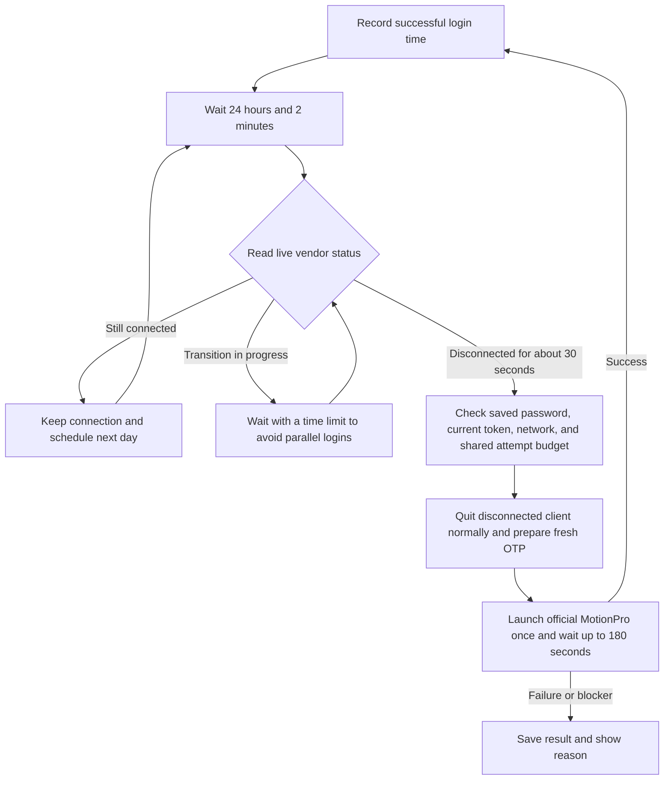

# MotionPro Guard OSS

An automatic recovery helper for MotionPro VPN on macOS, with a background app and a native desktop widget. **Current version: 1.6.1.** By default, it records the last successful login and checks the connection once **24 hours and 2 minutes** later. It reconnects only after confirming that the VPN is disconnected. It does not poll the VPN between scheduled checks.

Guard uses the static password saved by the official MotionPro client. For each login, it reads the current local MotionProOTP binding and calculates a one-time password (OTP). The default flow does not require the OTP window, an old copy of credentials in Guard's Keychain, or a model API.

**License: GNU GPL v3 or later (GPL-3.0-or-later).** See [LICENSE](LICENSE) for the full text. This is an independent community tool distributed as source code. MotionPro, MotionProOTP, and vendor libraries belong to their respective rights holders and are not included in this repository or its source archives.

## How it works



- Each successful login resets the schedule. If the VPN is still connected when the check is due, Guard schedules the next day. Unknown states do not trigger a restart. Starting Guard or clicking **Check now** (`立即检查`) also runs a check.
- Unexpected disconnections before the scheduled time are not detected immediately. The 24-hour interval is an expected session duration, not a guarantee that the server will disconnect at that time.
- Automatic and manual fallback logins share a limit of two submissions per rolling hour. Two consecutive submitted failures pause recovery. Readiness checks and waiting do not count as submissions.
- `launchd` keeps Guard running. The watchdog helper has no periodic trigger. Installation does not create a scheduled task for an AI assistant.
- The native widget shows **Scheduled recovery** (`定时恢复`). Click it to view the last successful login and the next recovery time. A saved snapshot during the waiting period is not live tunnel status.

See [Architecture](docs/architecture.md) and [Acceptance criteria](docs/acceptance.md) for the detailed sequence, interrupted-attempt recovery, and success criteria. The linked guides are currently in Chinese.

## Build and install

Requirements: macOS 14 or later, Xcode Command Line Tools, Python 3, and your own legally installed and configured copies of MotionPro and MotionProOTP. The app UI is currently in Chinese; exact button labels are included below.

1. Log in manually once with the official client, save the static password, and set the target VPN as the default site. Bind an OTP token separately on each computer.
2. Copy [project.example.json](project.example.json) to `project.local.json`. Set your gateway hostname without adding an account name or secrets.
3. Build and install with your own persistent code-signing identity:

   ```bash
   python3 build.py --config project.local.json --signing-identity YOUR_CERTIFICATE_SHA1
   python3 install.py --install 'dist/MotionPro Guard OSS.app'
   python3 install.py --enable-jobs
   open -a "$HOME/Applications/MotionPro Guard OSS.app" 'motionpro-guard-oss://open'
   ```

4. In the management window, click **Choose official OTP source** (`选择官方 OTP 数据源`) and select the local `VSite.plist` for your bound token. Click **Check login readiness** (`检查登录条件`) and **Check now** (`立即检查`). Confirm that a successful login time is recorded, then enable **Recover automatically after expected expiry** (`预计到期后自动恢复`).
5. Right-click the desktop, select **Edit Widgets**, and search for **MotionPro Guard OSS**.

Automatic recovery is disabled on first installation. The public edition uses the separate bundle identifier `org.motionproguard.app`, data directory `MotionProGuardOSS`, and URL scheme `motionpro-guard-oss`. It does not replace an existing Guard installation. Do not run two recovery engines at the same time.

See the [Setup guide](docs/setup.md) (Chinese) for full configuration, macOS permissions, and installation details.

## Build and test from source

```bash
python3 build.py --ad-hoc
python3 -m unittest discover -s Tests -p 'test_*.py'
python3 scripts/release_audit.py
```

`--ad-hoc` builds development artifacts and runs synthetic tests. It does not install or launch the app, or submit a VPN login. Installation requires your own persistent signing certificate. The author's certificate, private key, and pre-signed applications are not provided.

```bash
# Run only the Swift synthetic tests
python3 build.py --test-only
# Run only when the user explicitly requests a live status check
python3 scripts/preflight.py
python3 scripts/manual_attempt.py status
```

The reusable Codex skill is in [skills/motionpro-vpn-access](skills/motionpro-vpn-access/SKILL.md). Optional manual fallback templates are in [automation](automation/README.md). They require separate configuration and authorization and are not enabled during installation. These guides are currently in Chinese.

## Limitations and validation status

- Configuration encryption and decryption support only the two verified client builds identified in the source. Guard stops on a mismatch. Vendor keys and binaries are not included. See [Compatibility](docs/compatibility.md) (Chinese).
- Background OTP generation and scheduled triggering while the screen is locked are implemented. **A complete locked-screen reconnect with the current version, and recovery after a naturally expired session on a fresh public-edition installation, still require live testing.** Synthetic tests and a single successful login on the original machine do not establish either result.
- Guard does not run while the Mac is asleep, shut down, or logged out. It handles overdue checks after waking. Early disconnections require a user-initiated check.
- If logs cannot provide a trustworthy successful login time, Guard does not invent a schedule anchor. Restoring the VPN tunnel does not restore SSH/HPC sessions or application authentication.

## Distribution

This repository includes source code, synthetic tests, build and installation tools, sanitized diagnostics, and migration documentation. It excludes account credentials, OTP seeds and codes, official client configurations, Keychains, personal paths, certificate fingerprints, real logs, runtime state, and recovery backups.

[Changelog](CHANGELOG.md) · [Security](SECURITY.md) (Chinese)
